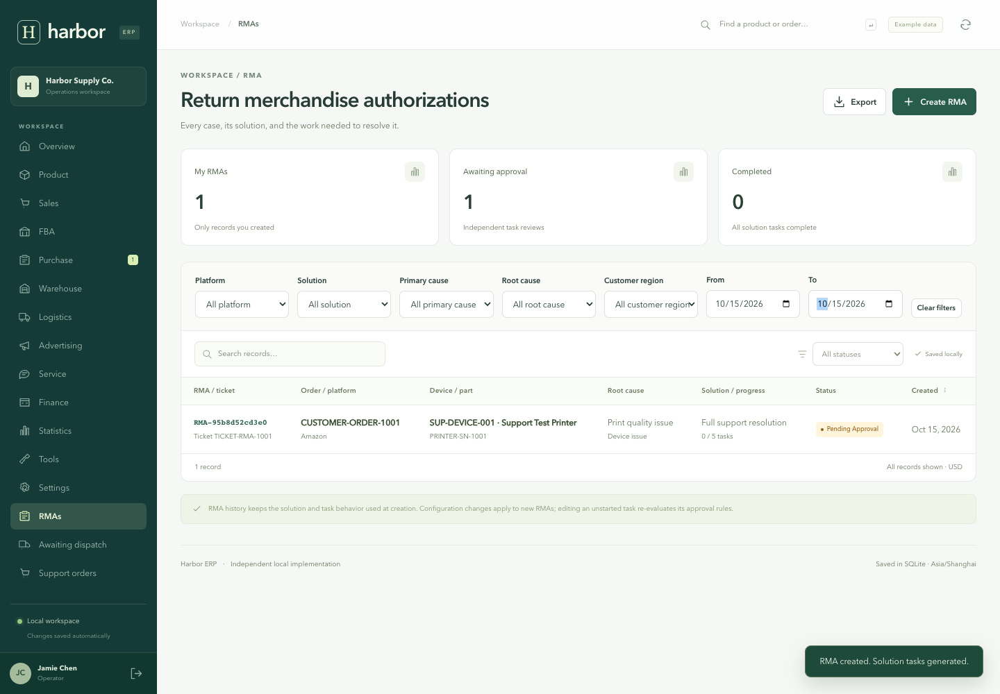
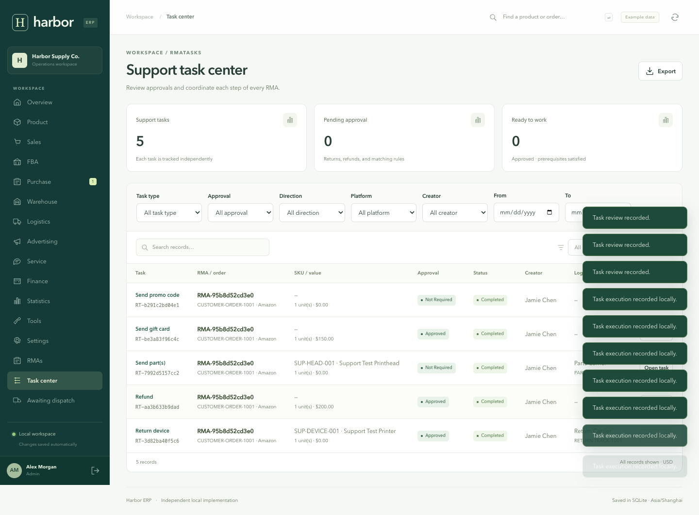
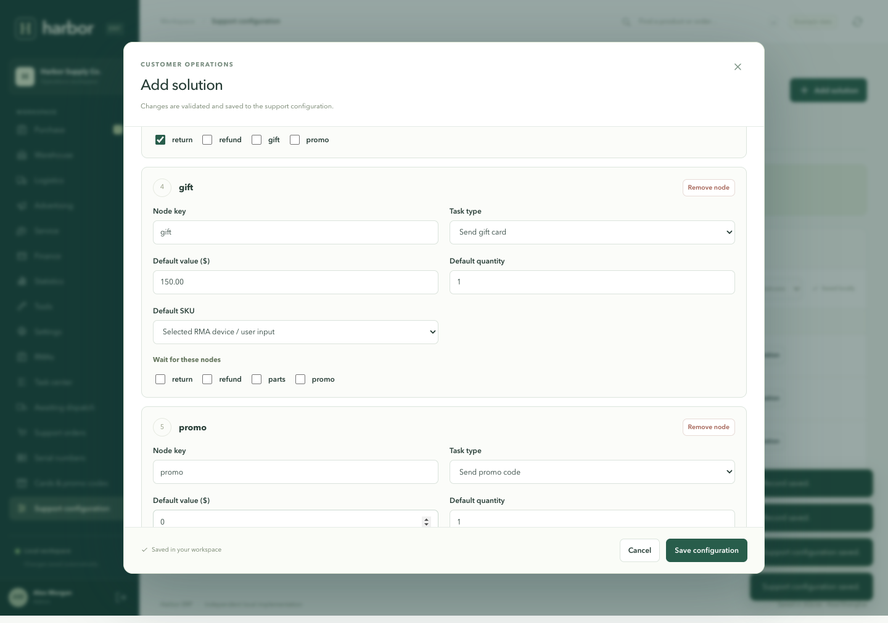
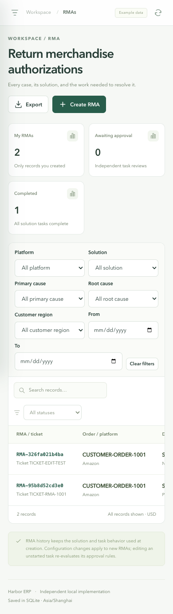

# Version 3 validation

Verified on **15 October 2026** on macOS arm64 with Go **1.27.2**, Gin **1.11.0**, GORM **1.31.1**, Node **24.19.0**, React **19.3.0**, Vite **7.3.7**, and Playwright **1.62.1**.

## Results

- **42 passing Go tests:** 14 ERP domain, 12 HTTP/integration, and 16 support workflow tests.
- **2 passing frontend normalization tests**, including legacy null collections and retention of configured DAG edges.
- `go test -race ./...` and `go vet ./...` passed.
- Frontend ESLint and production build passed.
- **36 browser checkpoints:** 19 ERP, 10 RMA, and 7 expanded audit checkpoints.
- All three browser suites reported zero JavaScript page errors.
- Existing workspace migration passed on an isolated copy. A direct comparison of the running app with `data/pre-rma-v3.sqlite` also confirmed that all 14 original business collections, settings, and revision were retained. Seven new pages and starter support configuration were added, with no QA RMAs/orders/serials added to the real workspace.

## RMA browser checkpoints

1. device and custom printhead SKUs, compatibility, and product filters.
2. admin creates required custom fields, SKU-specific root causes, and a five-node solution DAG without code.
3. support orders and linked device / printhead serials can be created and searched.
4. creator selects one solution and creates all five tasks with three independent approvals.
5. a second agent cannot see the case in UI, detail API, task data, or CSV exports.
6. admin reviews tasks independently while dependencies continue to block execution.
7. return receipt unlocks refund and parts; dispatch queue clears and all tasks complete.
8. sent gift card and promo code history supports type filters and code search.
9. admin-configured product and execution fields work; changing a gift value triggers a new approval.
10. owner case notes, completed-case visibility, responsive layout, and zero JavaScript errors.

## Blank-page fix and expanded audit

The shipped solution nodes encoded empty dependencies as JSON `null`. Selecting one made React read `dependsOn.length` and crash. The server now writes empty arrays and normalizes existing configurations, historical solution snapshots, and task collections on opening a workspace. The frontend also normalizes legacy responses. The audit deliberately injects the old null response and selects every starter solution. An error boundary provides recovery for unexpected rendering failures; normal-flow tests assert it is never displayed.

Additional fixes protect stale configuration/task forms, preserve case notes after a failed save, reuse idempotency receipts after a successful POST followed by a failed reload, and prevent rapid duplicate submissions. Changing an order to another device clears incompatible solution inputs. Serial identity and SKU classifications cannot break existing links; task execution rechecks current SKU compatibility. Configuration keys, dependency lists, field options, date values and product compatibility inputs receive stricter validation.

The expanded browser suite verifies:

1. All four starter solutions render with old null dependencies; saved dependencies are arrays.
2. All four solutions create RMAs; a simulated reload failure and retry creates exactly one case.
3. Returns, replacements, refunds, parts, gift cards and promo codes pass independent approval/execution; SQLite, task status, logistics queues and benefit history agree.
4. All five custom field types and six form scopes save; order/serial custom values and status edits persist.
5. Configuration creation, edits and disabling persist for platforms, root causes, rules, task types and fields. The RMA suite separately creates a custom solution DAG.
6. Stale configuration edits fail without overwriting a newer administrator save.
7. All 20 pages, unsupported routes, support CSV exports and authenticated server restart pass.

The running demo was also rebuilt and restarted after a consistent SQLite backup in ignored `data/pre-rma-bugfix.sqlite`. All four solution selections passed there. Business records, settings and configuration revision were unchanged; only legacy nullable collections were normalized. CRUD tests run against disposable databases, not the user's workspace.

## Backend edge cases

Tests cover trusted creator assignment; owner-filtered bootstrap, detail and CSV access; administrator visibility; atomic rejected operations; exact $100 approval boundaries; mandatory refund, built-in return and custom inbound-return approval; independent reviews and execution dependencies; return dispatch versus receipt; review invalidation after task edits; stale revision rejection; positive execution amounts; required refund/code references; exactly-once benefit history; request idempotency; cyclic/missing/duplicate DAG nodes; historical solution snapshots; root-cause enablement and SKU applicability; custom task types; required/custom select fields; execution field validation; serial uniqueness/type/parent validation; additive permission migration; and preservation of disabled custom fields without accepting hidden-field writes.

The original suite also retains purchase approval/partial receipts, inventory reservations and exact cent conservation, returns/refunds, warehouse transfers, historical COGS, timezone reports, login/session persistence, RBAC, exports, throttling, settings, mobile navigation and profit-calculator checks.

## Visual checks

Reviewed desktop RMA list and workflow configuration, task center, benefit history, and mobile RMA list at 390 × 844. The existing Harbor styling is preserved. Tables scroll within their containers; the tested mobile page has no document-level overflow. Native dialogs retain labels and focus management. This is not a formal accessibility certification.

## Scope

These results apply to the documented local workflows and representative edge cases. They do not establish production load capacity, complete Lingxing/RuoYi parity, external carrier/payment/marketplace compatibility, tenant isolation, general department data scopes, or exhaustive security/accessibility coverage. RMA ownership is implemented. Issuing/sending gift cards or promo codes, refunds and shipments are performed externally and recorded here.

See [the RMA guide](rma.md) for configuration, permissions, execution and recovery. Repeat with `npm run test:all`, `./scripts/go.sh test -race ./...`, and optional `npm run test:migration`. GitHub Actions runs the portable checks and saves browser reports. Browser screenshots and JSON reports are generated under ignored `test-results/`; committed screenshots show only test data.

## Warranty and bilingual feature validation — 16 October 2026

The warranty feature adds six Go tests, bringing the backend total to **48**. They cover device activation/grace boundaries, exclusive expiry, standalone/bundled printheads, leap years and month-end clamping, atomic rejection, scoped overrides, conflicting rules, immutable assessments, policy revisions and administrator-only changes. Two localization tests bring frontend/tooling unit tests to **4**. Frontend lint/build, `go vet` and `go test -race ./...` pass.

All original ERP/RMA/audit browser suites pass. The added warranty suite checks direct API rejection without partial records, live form eligibility, successful creation, persistent Settings rules, historical snapshots, stale-policy rejection and warranty-exempt solutions. The bilingual suite checks login, all 20 pages in Chinese, language persistence, changing language inside an unsaved form, original product names and canonical submitted values, actual sales returns in Chinese, translated warranty failures, and a 390px mobile layout without document overflow. All run on disposable databases and record no JavaScript page errors.

The implementation uses agent-entered delivery/activation evidence. It does not verify MES/Shopify facts, execute approved warranty corrections or implement repair-pause adjustments. Date-boundary choices and the interpretation of bundled printhead coverage are documented in the RMA guide. The language preference belongs to the browser; currency and business timezone remain independent.

## Udesk ticket center validation — 16 October 2026

Current navigation exposes 13 modules. The seven deferred ERP modules are hidden; direct UI routes show the disabled-module view. The original ERP browser scenario is preserved as `tests/legacy-erp-e2e.mjs` for those modules' eventual return. The current smoke, audit and bilingual suites assert the active navigation; sales-return accounting still has API coverage in the bilingual test.

The signed Udesk mock browser suite verifies live refresh and source-filter calls, duplicate filter IDs, 30 source field definitions plus an unknown field, option labels, inert external HTML, read-only conversation, saved/resumed RMA drafts, bilingual/mobile rendering, imported-account login, row permissions on list/detail/replies/export/number lookup/draft endpoints, and an upstream outage shown without stale rows. It uses a disposable database; tests explicitly disable live Udesk credentials unless a mock environment is provided.

Backend tests cover signatures, URL-encoded ticket numbers and fresh nonces; environment precedence; unknown source roles; source-disabled/disappeared accounts; requested password reset; exclusion of unrelated SIP credentials; own/group/admin scopes; revoked-role permission persistence; current source reassignment; field fidelity; immutable snapshots; atomic rollback and successful RMA linking; and idempotent resubmission. Existing RMA, audit, warranty, bilingual and proxy login browser suites pass alongside the current workspace smoke. Lint/build, unit tests, `go vet`, and race checks pass.

A limited live check on the configured tenant verifies signed reads, account synchronization (five accounts, nine groups), 30 custom-field definitions and 26 support-template fields, list/detail access and LAN proxy login. This does not establish full historical ingestion, webhook behavior or production load capacity. Udesk remains read-only; source personal filters execute as the configured integration account and are intersected with CRM scope. Draft saves require successful source refresh. External Shopify/MES facts and broad order/SN conflict resolution remain outside this change.

## Ticket center UI refinement — 2026-10-16

Verified the shared list controls, ticket deep links, populated-only details and source ID URL mapping with:

- `npm run check` (ESLint and production build)
- `npm test` (Go packages and frontend/i18n units)
- `npm run test:e2e`, `npm run test:rma`, `npm run test:i18n`
- `npm run test:audit`, `npm run test:warranty`, `npm run test:proxy`
- `npm run test:udesk` (current-page search/sort, source filters/refresh, clickable title, detail reload, empty-field omission, retained zero/false values, v1/v2 custom-field merge, read-only source links, draft persistence, row authorization, bilingual/mobile and outage behavior)
- `./scripts/go.sh vet ./...`

Live LAN checks confirmed #717 uses `/entry/ticket/show/20713607`, ticket-detail links survive navigation and browser Back restores the list. Screenshots inspected during iteration include the original queue, CRM reference, English/Chinese queue and detail, actual #717, and 390px mobile queue/detail. The mobile queue uses cards, and document width stays within the viewport.

Screenshots are local ignored artifacts in `test-results/`: `tickets-before.png`, `ticket-queue-live-zh.png`, `ticket-detail-live-preview.png`, `ticket-717-live-zh.png`, `ticket-detail-en.png`, `ticket-detail-zh.png`, `ticket-detail-mobile.png`, `ticket-queue-mobile.png`. Live screenshots contain tenant/customer information; synthetic screenshots use the isolated mock fixture.
