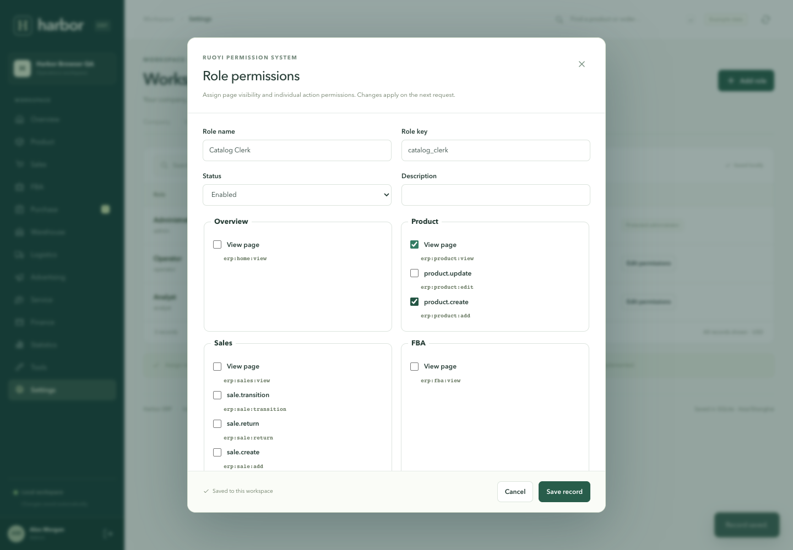

# Validation record

Verified on **15 October 2026** on macOS arm64 with **Go 1.27.2**, Gin **1.11.0**, GORM **1.31.1**, Node **24.19.0**, React/React DOM **19.3.0**, Vite **7.3.7**, and Playwright **1.62.1**.

## Automated checks

- **22 passing Go tests:** 13 domain tests and 9 HTTP/integration tests.
- `go test -race ./...` passed, including concurrent transactional writes.
- `go vet ./...` passed.
- Frontend ESLint undefined-variable checks and Vite production build passed.
- **19 passing end-to-end browser checkpoints** against the built React frontend and compiled Gin server.
- Browser result: **zero JavaScript page errors** and **zero unexpected failed requests**.
- Existing legacy SQLite migration verified on a consistent temporary copy; original business collections/settings/version were unchanged, legacy login worked, and three RuoYi roles initialized.
- `./start.sh` successfully rebuilt and launched the migrated application at port 4317 with the existing database. `/api/health` identifies React, Go/Gin, RuoYi-adapted RBAC, and SQLite.

## Domain and server coverage

Partial and final purchase receipts; atomic failed multi-line receipts; duplicate/fractional quantity rejection; payment bounds and paid-document cancellation rejection; sales reservation, shipment recognition, insufficient-stock rollback, cancellation release; returns and refunds; exact cent conservation across mixed-cost inventory, transit, transfers, and repeated returns; reserved-stock isolation; historical cost stability; timezone/date/channel reporting and original-date return restatement; expenses; legacy scrypt and new bcrypt verification.

Authentication and secret exclusion; cookie flags and logout; built-in role enforcement; custom page/action grants; multi-role union; role disablement and live permission revocation; account disablement; protected reads and bootstrap document redaction; menu visibility versus disabled permissions; administrator protection; failed permission changes rolling back; persistent permissions/sessions after database reopen; idempotent replay/conflict rejection; concurrent writes; report validation; origin/host checks; CSV formula neutralization; login throttling.

## Browser checkpoints

1. administrator login and live dashboard.
2. all 12 operational modules render without page errors.
3. product creation, editing, persistence, and table search.
4. multi-line purchasing: approval, partial receipt, final receipt, and payment.
5. sales confirmation, fulfillment, payment, return, refund, and inventory reversal.
6. warehouse transfer: reservation, transit, and destination receipt.
7. inventory adjustment and searchable movement ledger.
8. insufficient-stock rejection is displayed and draft state is preserved.
9. finance expense entry and real CSV export.
10. manual campaign tracking and pause state.
11. ticket creation, internal note, progress, and resolution.
12. operational tasks and zero-price-safe profit calculator.
13. reports recompute by date and channel with proper empty states.
14. company settings, user creation, and reload persistence.
15. custom role editor, user assignment, multi-role union, hidden actions, and live server revocation.
16. global product search routes to a filtered catalog.
17. mobile layout has no page overflow and navigation works.
18. analyst has read-only UI and server-enforced write rejection.
19. no browser JavaScript errors or unexpected failed requests.

## Data preservation and visual review

Migration compared all 14 business collections: products (6), suppliers (2), warehouses (3), stocks (18), purchases (4), sales (18), shipments (0), movements (37), payments (19), expenses (2), campaigns (2), tickets (1), tasks (2), and audit (15). These were exactly unchanged, along with preferences and revision. A complete pre-switch backup is retained at ignored `data/pre-react-gin.sqlite`. Tests use temporary databases and do not add their QA records to the delivered workspace.

Reviewed the React dashboard at 1440 × 1000, catalog at 390 × 844, and custom role editor. The established Harbor colors, typography, spacing, cards, sidebar and form treatment are retained. Wide tables scroll within their containers; mobile has no page-level overflow. Dialogs retain native focus management and labels. This is not a formal accessibility certification.

## Verification boundaries

These results cover the documented local workflows and representative edge cases. They do not establish production load capacity, full Lingxing or RuoYi feature parity, external marketplace/carrier compatibility, department/row-level data scopes, tenant isolation, statutory accounting, or exhaustive security/accessibility coverage. RuoYi-Go is a focused, attributed RBAC adaptation; no upstream UI is used.

Repeat with `npm run check`, `npm test`, `npm run vet`, `./scripts/go.sh test -race ./...`, and `npm run test:e2e`. Optional legacy-data migration check: `npm run test:migration`. See README for runtime/browser setup. Detailed JSON reports and generated screenshots are in ignored `test-results/`.
