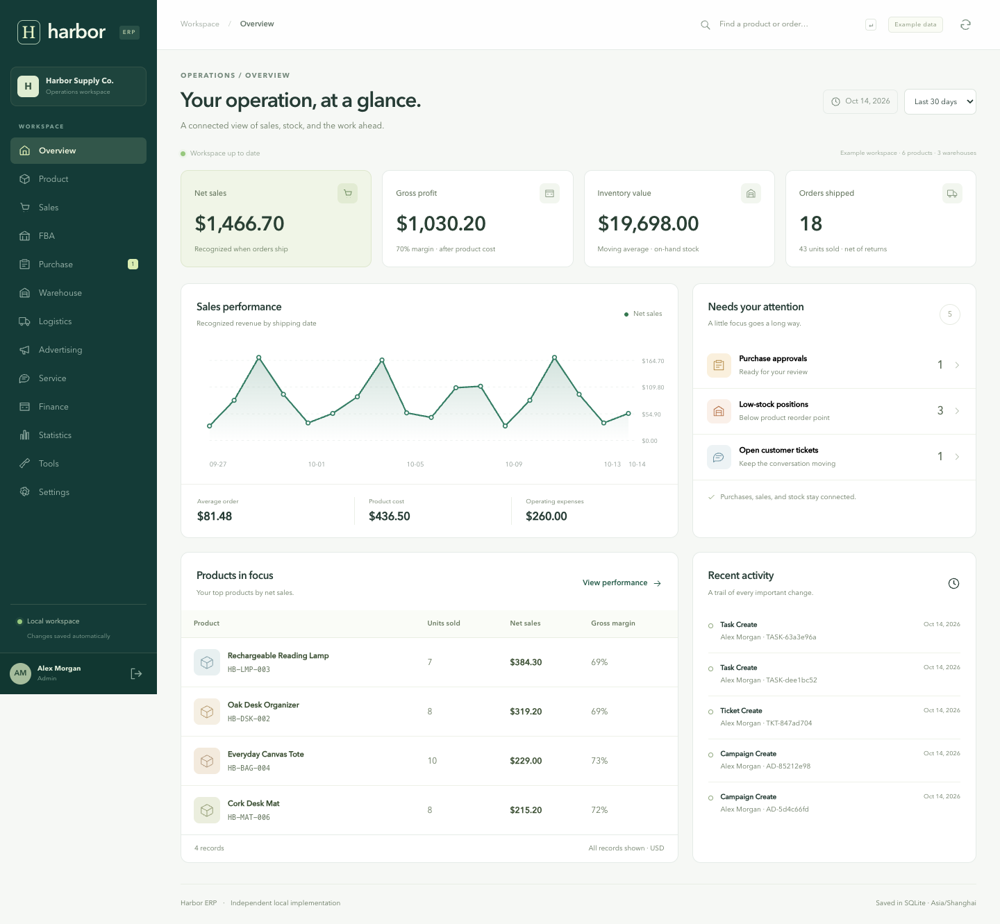
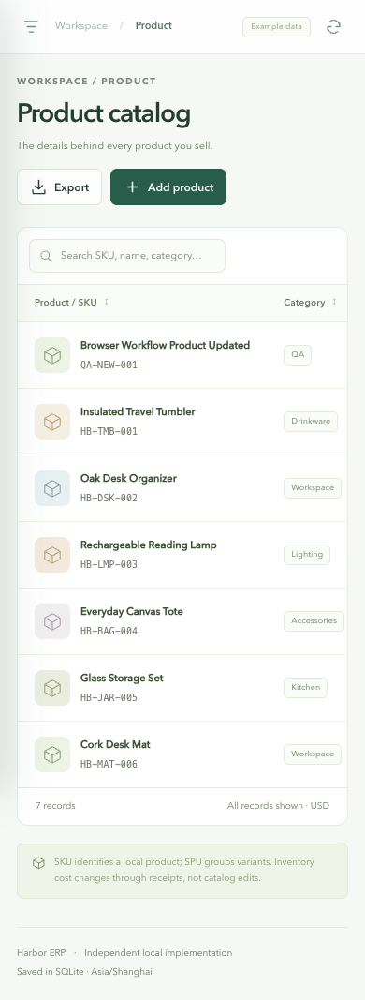

# Validation record

Verified on **14 October 2026** on macOS with Node **24.19.0**, built-in SQLite **3.53.3**, Playwright **1.62.1**, and Chrome for Testing **147.0.7727.15**.

## Automated checks

- **33 passing Node test checks**, including 20 domain tests and 12 HTTP subtests inside their integration test.
- **18 passing end-to-end browser checkpoints**.
- JavaScript syntax checks passed for the server, domain, and browser app.
- Browser tests reported **zero JavaScript page errors** and **zero unexpected failed requests**.
- All tests used isolated in-memory or temporary SQLite data. Browser changes do not appear in the delivered example workspace.

### Domain and HTTP coverage

Atomic partial/multi-line receipts; quantity validation; approval and ordering transitions; reservation and insufficient-stock rejection; reservation release; shipment and return recognition; payment bounds; exact inventory-cent conservation across mixed costs and transfers; original-cost returns; historical COGS stability; expense effects; company-timezone/date/channel reporting; authentication; persistent database and sessions after server restart; HttpOnly/SameSite cookies; idempotent request replay/conflict rejection; role-based write restrictions; disabled-user session rejection; cross-origin write rejection; password exclusion from API exports; CSV formula neutralization; logout invalidation.

### Browser checkpoints

1. Administrator login and live dashboard.
2. All 12 operational module screens.
3. Product creation, editing, persistence, and table search.
4. Multi-line purchasing, approval, partial/final receipt, payment.
5. Sales confirmation, shipping, payment, return, refund, stock reversal.
6. Warehouse transfer reservation, dispatch, receipt.
7. Inventory adjustment and searchable movement ledger.
8. Insufficient-stock error and preserved draft state.
9. Expense entry and a real CSV download.
10. Manual campaign tracking and pause state.
11. Ticket creation, internal notes, progress, resolution.
12. Task completion and zero-price-safe profit calculator.
13. Date/channel report filters and empty results.
14. Settings, user creation, and reload persistence.
15. Global product search.
16. Mobile navigation and no page-level horizontal overflow at 390 × 844.
17. Analyst read-only UI and server-enforced rejection.
18. No browser JavaScript errors or unexpected failed requests.

## Visual review

Desktop dashboard reviewed at **1440 × 1000**; mobile product catalog at **390 × 844**. Wide tables scroll within their containers on mobile. Supporting text contrast and sizing were increased after visual inspection. Forms use native modal dialogs, labels, browser validation, keyboard focus containment, and visible server errors. This is not a formal accessibility certification.

## Verification boundaries

These results apply to the documented local workflows and representative edge cases. They do not establish production load capacity, complete Lingxing parity, external marketplace/carrier compatibility, tax/FX/statutory accounting compliance, or exhaustive security/accessibility coverage.

Run `npm test`, `npm run check`, and `npm run test:e2e` as documented in the README to repeat the checks. Browser result JSON and detailed screenshots are generated in ignored `test-results/`.
